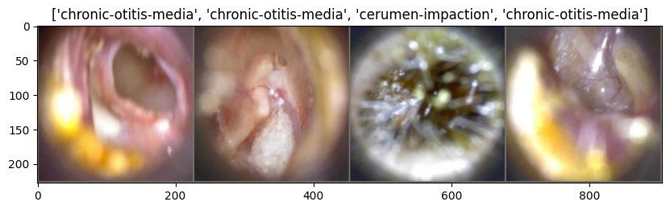

# Otitis Media Detection Using Transfer Learning

Otitis Media Detection using Transfer Learning is a deep learning technique that uses pre-trained models to quickly and accurately diagnose middle ear infections. The method involves fine-tuning pre-trained models on images of the middle ear to detect signs of Otitis Media. This approach can significantly reduce the time and error associated with manual inspections and improve the accuracy of diagnosis, making it a valuable tool for medical professionals.

ResearchGate Technical Report: https://www.researchgate.net/publication/375893659_Otitis_Media_Detection_Using_Deep_Learning
### For frontend

```bash
# Go to the project directory
$ cd frontend

# Install dependencies
$ npm install

# copy env file
cp .env.example .env.local

# Start the server
$ npm run dev
```

### For Backend

```bash
# Go to the project directory
$ cd backend

# create env
$ python -m venv venv
$ source venv/bin/activate

# Install dependencies
$ pip install -r requirements.txt

# copy env file
cp .env.example .env

# Start the server
$ python manage.py serve
```


#### Preview


#### System Architecture


#### Some Examples


## Tech Stack

**Client:** NextJs, TailwindCSS

**Server:** Python, FastAPI, PyTorch, ONNX

## Authors

- [Mada Nithish Reddy](https://www.github.com/nithish6606)
